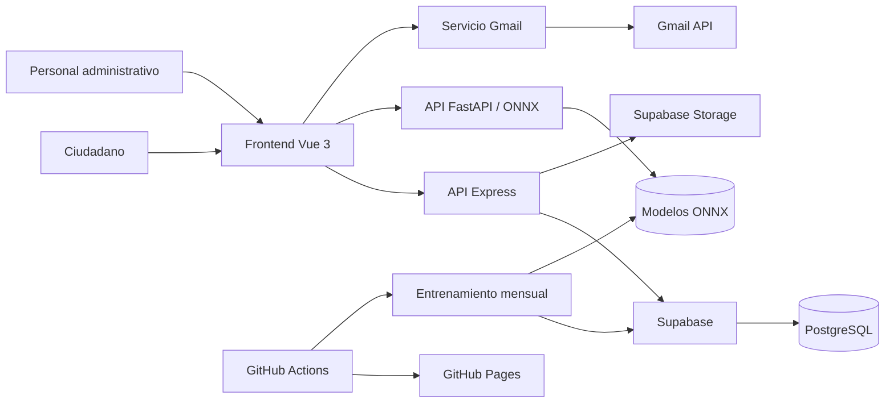
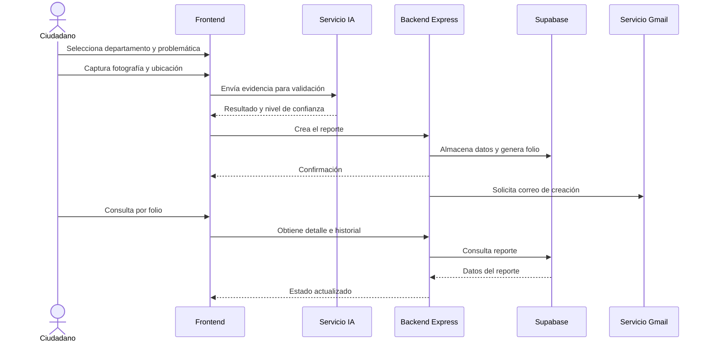

# GeoReporte C2026

<p align="center">
  
</p>

<h3 align="center">
  Conecta a la ciudadanía con los servicios públicos
</h3>

<p align="center">
  <a href="https://airam2w.github.io/GeoReporte_C2026/">
    
  </a>
  <a href="#instalación-y-ejecución">
    
  </a>
  <a href="#arquitectura-del-sistema">
    
  </a>
</p>

<p align="center">
  
  
  
  
  
  
</p>

---

## Tabla de contenido

| | | |
|---|---|---|
| [Presentación](#presentación) | [Arquitectura](#arquitectura-del-sistema) | [Instalación](#instalación-y-ejecución) |
| [Objetivos](#objetivos) | [Datos y servicios](#modelo-de-datos) | [Pruebas](#pruebas) |
| [Funciones](#funciones-principales) | [Roles y perfiles](#roles-y-flujo-administrativo) | [Despliegue](#despliegue) |
| [Tecnologías](#tecnologías) | [Configuración](#configuración-del-entorno) | [Seguridad](#seguridad-y-privacidad) |

---

## Presentación

**GeoReporte** es una plataforma diseñada para facilitar la comunicación entre la ciudadanía y las áreas municipales responsables de los servicios públicos.

La aplicación permite que una persona registre una incidencia desde su teléfono o computadora, adjunte una fotografía como evidencia, seleccione el área municipal correspondiente y proporcione la ubicación exacta del problema. Cada reporte recibe un folio que puede consultarse en cualquier momento para conocer su avance.

Del otro lado de la plataforma, el personal municipal dispone de paneles diferenciados para revisar reportes, asignar responsables, cambiar prioridades, registrar evidencias, cerrar incidencias y mantener una comunicación documentada con los ciudadanos.

Todo el proceso se encuentra respaldado por:

- Identificación única de cada reporte.
- Ubicación geográfica y visualización de incidencias.
- Validación automática de fotografías.
- Historial de cambios y asignaciones.
- Correos electrónicos sobre eventos relevantes.
- Acceso por perfiles y permisos.

<div align="center">

| Ciudadano | Personal municipal | Sistema |
|:---:|:---:|:---:|
| Reporta y consulta | Administra y asigna | Valida, registra y comunica |
| Evidencia y ubicación | Prioriza y da seguimiento | Conserva trazabilidad |

</div>

## ¿Cómo funciona?

```mermaid
flowchart LR
    A["Ciudadano identifica el problema"] --> B["Completa el reporte"]
    B --> C["Adjunta foto y ubicación"]
    C --> D["La IA verifica la evidencia"]
    D --> E["Se genera un folio"]
    E --> F["Personal municipal da seguimiento"]
    F --> G["Ciudadano consulta el estado"]

    style A fill:#F4F4F4,stroke:#17324D
    style B fill:#FFFFFF,stroke:#17324D
    style C fill:#FFFFFF,stroke:#17324D
    style D fill:#D68C00,stroke:#8B1538,color:#FFFFFF
    style E fill:#8B1538,stroke:#8B1538,color:#FFFFFF
    style F fill:#FFFFFF,stroke:#17324D
    style G fill:#17324D,stroke:#17324D,color:#FFFFFF
```



## Objetivos

GeoReporte nace con una finalidad práctica: mejorar la forma en que las solicitudes ciudadanas se reciben, organizan y atienden dentro de las áreas municipales.

### Objetivo general

Centralizar y automatizar el registro y seguimiento de reportes ciudadanos para mejorar la trazabilidad de las incidencias y apoyar la asignación de recursos públicos.

### Objetivos específicos

- Facilitar el acceso ciudadano a la creación y consulta de reportes.
- Clasificar incidencias por departamento y problemática.
- Validar automáticamente la correspondencia entre la fotografía y el área reportada.
- Incorporar ubicación geográfica y evidencias visuales.
- Gestionar reportes mediante roles con permisos diferenciados.
- Mantener un historial auditable de asignaciones, estados y observaciones.
- Automatizar la comunicación por correo electrónico.
- Actualizar periódicamente los modelos de visión artificial con evidencia aprobada.

## Funciones principales

### Para la ciudadanía

| Función | Beneficio |
|---|---|
| Crear un reporte | Permite describir una incidencia y compartirla con el área correspondiente sin iniciar sesión. |
| Agregar fotografía | Conserva evidencia visual del problema y mejora su clasificación. |
| Seleccionar ubicación | Vincula el reporte con el punto geográfico donde ocurre la incidencia. |
| Consultar por folio | Facilita conocer el estado y la trazabilidad de la solicitud. |
| Recibir comunicados | Informa sobre eventos como la creación, rechazo, turnado o finalización. |

### Para el personal municipal

| Función | Beneficio |
|---|---|
| Paneles por perfil | Presenta únicamente las herramientas pertinentes para cada responsabilidad. |
| Gestión de catálogos | Permite administrar departamentos, problemáticas y usuarios. |
| Asignación de responsables | Conecta cada reporte con supervisores y jefes de área. |
| Control de estados | Ofrece seguimiento desde el registro hasta el cierre. |
| Evidencias de avance | Documenta las acciones realizadas durante la atención. |
| Prioridades | Ayuda a distinguir y organizar incidencias según su importancia. |
| Historial | Conserva fechas, notas, responsables y cambios realizados. |
| Reportes PDF | Genera documentos para consulta o entrega administrativa. |

### Tecnología aplicada

- Verificación de formularios con Cloudflare Turnstile.
- Validación de evidencias con modelos ONNX.
- Captura de coordenadas y mapas con Leaflet.
- Autenticación administrativa con JWT.
- Persistencia y almacenamiento con Supabase.
- Comunicación automatizada por Gmail API.
- Pruebas unitarias, E2E y de carga.

## Arquitectura del sistema



### Flujo de un reporte



## Tecnologías

### Frontend

| Componente | Tecnología |
|---|---|
| Framework | Vue 3 |
| Lenguaje | TypeScript |
| Build tool | Vite |
| Gestión de estado | Pinia |
| Enrutamiento | Vue Router |
| Mapas | Leaflet |
| Estilos | CSS |
| Componentes e iconos | PrimeIcons / Bootstrap Icons |
| Alertas | SweetAlert2 |
| Documentos PDF | jsPDF |
| Seguridad de formularios | Cloudflare Turnstile |
| Unit testing | Vitest / Vue Test Utils |
| E2E testing | Cypress |

### Backend y servicios

| Componente | Tecnología |
|---|---|
| API principal | Node.js 22, Express 5 |
| Base de datos | Supabase / PostgreSQL |
| Almacenamiento | Supabase Storage |
| Autenticación administrativa | JWT |
| Validación IA | FastAPI, ONNX Runtime |
| Procesamiento de imágenes | Pillow, NumPy |
| Notificaciones | Gmail API |
| Pruebas de carga | k6 |

### Inteligencia Artificial

- Exportación de modelos YOLO a formato ONNX.
- Ejecución en CPU mediante ONNX Runtime.
- Carga diferida de modelos para reducir uso de memoria.
- Semáforo de concurrencia para limitar inferencias simultáneas.
- Umbrales de confianza configurados por departamento.
- Soporte para detección de objetos y clasificación.

## Áreas de atención

Los catálogos iniciales incluyen siete áreas operativas y sus respectivos modelos:

| Departamento | Modelo ONNX | Modelo de IA |
|---|---|---|
| Limpia, recolección y disposición final | `limpieza.onnx` | Detección |
| Parques y Jardines | `parques.onnx` | Clasificación |
| Alumbrado público | `alumbrado.onnx` | Detección |
| Mercados y comercio callejero | `mercados.onnx` | Detección |
| Panteones | `panteones.onnx` | Detección |
| Conservación de infraestructura vial | `baches.onnx` | Detección |
| Sistemas de drenaje pluvial | `drenaje.onnx` | Detección |

Los modelos se encuentran en `backend/AI/models/`. Las fotografías utilizadas para el reentrenamiento pueden llevar identificadores especiales: `-2` para negativas, `-3` para excluidas y `0` para las positivas ya utilizadas.

## Roles y flujo administrativo

La interfaz redirige a cada usuario según su `tipo_id` contenido en el JWT:

| Tipo | Ruta | Panel |
|---:|---|---|
| 1 | `/management` | Director o administración general |
| 2 | `/dashboard` | Administrador |
| 3 | `/supervisor` | Supervisor |
| 4 | `/jefe` | Jefe operativo |
| 6 | `/external` | Administrador externo |

Las rutas del backend verifican el token, confirman que el usuario tenga estado administrativo `Alta`, comparan el rol contra la base de datos y restringen operaciones a los tipos autorizados.

Los paneles permiten administrar catálogos, usuarios, departamentos, problemáticas, asignaciones y estados. Los supervisores y jefes trabajan sobre reportes asociados a su ámbito, mientras que las funciones de mayor administración están reservadas para los roles correspondientes.

## Estructura del repositorio

```text
GeoReporte_C2026/
├── .github/workflows/          # CI, despliegue y actualización mensual de IA
├── frontend/
│   ├── src/
│   │   ├── assets/             # Imágenes, logos y hojas de estilo
│   │   ├── components/         # Componentes Vue y modales
│   │   ├── composable/         # Composables
│   │   ├── logic/              # Lógica auxiliar de vistas
│   │   ├── router/             # Rutas y control de acceso
│   │   ├── services/           # Clientes HTTP para APIs
│   │   ├── stores/             # Estado con Pinia
│   │   ├── utils/              # Utilidades
│   │   └── views/              # Vistas principales y paneles
│   ├── cypress/                # Pruebas E2E y fixtures
│   ├── supabase/migrations/    # Evolución del esquema de base de datos
│   └── package.json
├── backend/
│   ├── AI/
│   │   ├── main.py             # Servicio FastAPI de clasificación/detección
│   │   ├── models/             # Modelos ONNX
│   │   ├── pruebas_img/        # Imágenes de prueba
│   │   └── codigo entrenamiento/
│   ├── SUPABASE/
│   │   ├── src/
│   │   │   ├── routes/         # Endpoints GET, POST, PUT y DELETE
│   │   │   ├── middleware/     # JWT, Turnstile y autorización
│   │   │   ├── config/         # Conexión con Supabase
│   │   │   └── utils/          # Mapas, historial y respuestas
│   │   └── k6/                 # Pruebas de rendimiento
│   └── GMAIL/
│       └── index.js            # Servicio de correos
├── scripts/
│   └── actualizar_modelos.py   # Reentrenamiento y publicación de ONNX
├── package.json                # Dependencias auxiliares de la raíz
├── GeoReporte QR.png           # Código QR del proyecto
└── README.md
```

## Modelo de datos

La estructura PostgreSQL se gestiona mediante las migraciones de `frontend/supabase/migrations/`. El esquema incluye, entre otras entidades:

- `usuarios`
- `tipousuario`
- `departamentos`
- `departamentos_externos`
- `problemas`
- `problemas_externos`
- `administradores_internos`
- `administradores_externos`
- `supervisores`
- `jefes`
- `reportes`
- `detalle_reporte`
- `estadoreporte`
- `historial_reporte`
- `categoria_historial`
- `titulo_historial`
- `fotos_avance`

Los reportes contienen identificación mediante folio, descripción, datos opcionales de contacto, domicilio, referencias, fotografía, coordenadas y relaciones con departamentos, problemáticas y estado. Las migraciones agregan progresivamente prioridad, fechas de inicio y cierre, latitud, longitud, historial, relaciones y reglas de almacenamiento.

Las evidencias se alojan en buckets de Supabase Storage. La política incluida para el bucket `fotos` permite cargas anónimas de archivos con extensión JPG, JPEG, PNG o WebP únicamente dentro de la carpeta `evidencias`.

## Configuración del entorno

No se deben confirmar secretos ni archivos `.env` en el repositorio. A continuación se resumen las variables utilizadas por el proyecto.

### Frontend

Crear `frontend/.env` con:

```dotenv
VITE_BACKEND_URL=https://tu-servicio-express
VITE_AI_BACKEND_URL=https://tu-servicio-ia
VITE_GMAIL_SERVICE=https://tu-servicio-gmail
VITE_TURNSTILE_SITE_KEY=tu_clave_publica_turnstile
```

### API Express/Supabase

Crear `backend/SUPABASE/src/.env` o configurar las variables en el proveedor de hosting:

```dotenv
PORT=3000
VITE_SUPABASE_URL=https://tu-proyecto.supabase.co
SUPABASE_SERVICE_ROLE_KEY=tu_clave_de_servicio
JWT_SECRET=tu_secreto_jwt
TURNSTILE_SECRET_KEY=tu_clave_privada_turnstile
```

### Servicio Gmail

Crear `backend/GMAIL/.env` con las credenciales OAuth correspondientes:

```dotenv
PORT=3000
GMAIL_CLIENT_ID=tu_client_id
GMAIL_CLIENT_SECRET=tu_client_secret
GMAIL_REDIRECT_URI=tu_uri_de_redireccion
GMAIL_REFRESH_TOKEN=tu_refresh_token
GMAIL_USER_EMAIL=correo_remitente
BUSCADOR_URL=https://tu-sitio/GeoReporte_C2026/
MARCAR_IMPORTANTE=true
```

### Actualización automática de modelos

GitHub Actions utiliza:

```dotenv
SUPABASE_URL=https://tu-proyecto.supabase.co
SUPABASE_SERVICE_ROLE_KEY=tu_clave_de_servicio
EPOCHS=5
MIN_IMAGENES=20
CONF_ETIQUETA=0.5
RATIO_NEGATIVAS=0.5
```

## Instalación y ejecución

### Requisitos previos

- Node.js 22.18 o una versión compatible con el paquete declarado por el frontend.
- npm.
- Python 3.10 o superior.
- Acceso a un proyecto Supabase.
- k6, opcional, para las pruebas de rendimiento.
- Cuenta Gmail/API de Google, opcional, para las notificaciones.
- Supabase CLI, opcional, para administrar migraciones.

### 1. Clonar el repositorio

```powershell
git clone https://github.com/Airam2W/GeoReporte_C2026.git
cd GeoReporte_C2026
```

### 2. Frontend

```powershell
cd frontend
npm ci
npm run dev
```

El servidor de Vite utiliza la ruta base `/GeoReporte_C2026/` y estará disponible normalmente en `http://localhost:5173/GeoReporte_C2026/`.

Construcción de producción:

```powershell
npm run build
npm run preview
```

### 3. API Express/Supabase

```powershell
cd backend/SUPABASE
npm ci
npm start
```

La API escucha por defecto en `http://localhost:3000`.

### 4. Servicio de IA

Desde `backend/AI`:

```powershell
python -m pip install fastapi uvicorn python-multipart onnx onnxruntime pillow opencv-python-headless numpy
uvicorn main:app --reload --host 0.0.0.0 --port 8000
```

El endpoint principal de salud es `GET /health`; la validación se realiza mediante `POST /validarAI/{departamento}` con un archivo de imagen.

Ejemplo de departamentos válidos:

- `limpieza`
- `parques`
- `alumbrado`
- `mercados`
- `panteones`
- `calles`
- `drenaje`

### 5. Servicio Gmail

```powershell
cd backend/GMAIL
npm ci
npm start
```

El servicio expone operaciones para correos de creación, rechazo, finalización, turnado y envío de PDF.

### 6. Migraciones de Supabase

Las migraciones están en `frontend/supabase/migrations/`. Desde `frontend`:

```powershell
npx supabase db push
```

Este comando requiere haber vinculado previamente el proyecto local a un proyecto Supabase válido.

## Pruebas

### Pruebas unitarias

Desde `frontend`:

```powershell
npm run test:unit
```

La suite cubre vistas y componentes relevantes, incluyendo creación de reportes, inicio de sesión, redirección por rol, paneles, retroalimentación de IA y modales administrativos.

### Pruebas E2E

Modo interactivo:

```powershell
npm run test:e2e:dev
```

Modo automatizado contra la construcción:

```powershell
npm run build
npm run test:e2e
```

Las pruebas Cypress utilizan el servidor local en el puerto `4173` y el prefijo `/GeoReporte_C2026/`.

### Pruebas de carga

Desde `backend/SUPABASE`:

```powershell
npm run test:k6:smoke
npm run test:k6:load
npm run test:k6:heavy
```

Las pruebas requieren k6 instalado de forma externa y variables `K6_BASE_URL`, `K6_LOGIN_EMAIL` y `K6_LOGIN_PASSWORD`. Deben ejecutarse primero en entornos locales o de prueba y no contra producción.

## Despliegue

### Frontend

El workflow `.github/workflows/deploy.yml` instala las dependencias, ejecuta pruebas, genera el directorio `dist` y publica en GitHub Pages al recibir cambios en `main`.

Los valores de entorno se leen desde los secretos de GitHub:

- `VITE_BACKEND_URL`
- `VITE_AI_BACKEND_URL`
- `VITE_GMAIL_SERVICE`
- `VITE_TURNSTILE_SITE_KEY`

### Backend

Los servicios Express y FastAPI pueden desplegarse en plataformas compatibles con Node.js y Python. Los servicios deben estar configurados con sus variables de entorno correspondientes y aceptar solicitudes desde el origen del frontend.

La API Express expone `/health` para verificaciones de disponibilidad. El servicio IA expone `/health` y `/`.

### Automatización de IA

El workflow `.github/workflows/actualizar_ia.yml` se ejecuta el primer día de cada mes a las 07:00 UTC y también puede iniciarse manualmente. Entrena los modelos con evidencia obtenida de Supabase, valida los archivos ONNX, realiza el commit de los modelos modificados y los publica en `main`.

## Seguridad y privacidad

- Las operaciones administrativas exigen JWT válido.
- El backend revalida el estado administrativo y el rol directamente en Supabase.
- Los formularios públicos utilizan Turnstile para reducir envíos automatizados.
- Las claves privadas, refresh tokens y secretos se mantienen fuera del control de versiones.
- Las claves de servicio de Supabase deben utilizarse únicamente en el backend.
- La política de evidencia limita los formatos y la ubicación de archivos aceptados.
- El frontend elimina el JWT si una petición recibe una respuesta de sesión expirada o no válida.
- Los datos personales deben manejarse conforme a las disposiciones aplicables de privacidad y protección de datos de GeoReporte.

Como medida de seguridad futura o antes de un despliegue público ampliado, se recomienda revisar políticas RLS de Supabase, rotación de secretos, rate limiting, límites de tamaño de archivo y cabeceras HTTP.

## Actualización de modelos de IA

El script `scripts/actualizar_modelos.py` obtiene modelos `.pt` y `.onnx`, reúne imágenes positivas y negativas desde Supabase, prepara datasets, entrena y exporta nuevos modelos en formato ONNX.

El proceso contempla:

- Entrenamiento independiente para cada área.
- Selección de imágenes positivas asociadas al departamento.
- Uso de imágenes negativas compartidas.
- Exclusión de fotografías marcadas con `-3`.
- Validación local antes de publicar.
- Actualización transaccional y restauración ante fallos.
- Marcado posterior de imágenes utilizadas.
- Eliminación de archivos temporales.
- Confirmación automática de modelos modificados mediante GitHub Actions.

Los umbrales, épocas y cantidad mínima de imágenes pueden configurarse mediante variables de entorno. El reentrenamiento no garantiza por sí mismo la calidad final; debe existir una estrategia de revisión y validación de resultados antes de depender del modelo en procesos críticos.

## Alcance académico y técnico

GeoReporte fue concebido como una solución integral de desarrollo de software aplicada a la atención de necesidades ciudadanas. El proyecto reúne áreas como ingeniería de software, bases de datos, seguridad, infraestructura web, visión artificial, automatización y experiencia de usuario.

Su implementación permite explorar y demostrar los siguientes temas:

- Integración frontend-backend.
- Arquitectura basada en servicios.
- Persistencia relacional y almacenamiento de objetos.
- Control de acceso por roles.
- Procesamiento asíncrono de imágenes.
- Implementación de modelos ONNX en producción.
- Gestión de datos geográficos.
- Reentrenamiento automatizado.
- CI/CD y despliegue continuo.
- Pruebas unitarias, E2E y de carga.
- Trazabilidad de operaciones administrativas.

Las pruebas de carga actuales se concentran en el inicio de sesión y la consulta de catálogos. Una evaluación completa antes de poner el sistema a disposición de una gran cantidad de usuarios debe incluir disponibilidad, resistencia, seguridad y carga con archivos multimedia.

## Proyecto y acceso

<div align="center">


<br>

[](https://github.com/Airam2W/GeoReporte_C2026)
[](https://airam2w.github.io/GeoReporte_C2026/)

</div>

GeoReporte es un proyecto académico orientado a mejorar la gestión de reportes ciudadanos.

### Licencia

El repositorio no contiene actualmente una licencia formal. Antes de distribuir públicamente el código, los modelos o los datos, corresponde seleccionar una licencia y documentar explícitamente las condiciones de uso de las imágenes, datos ciudadanos y activos municipales.
